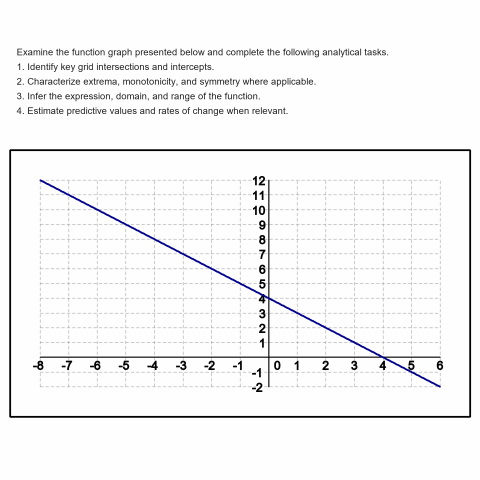
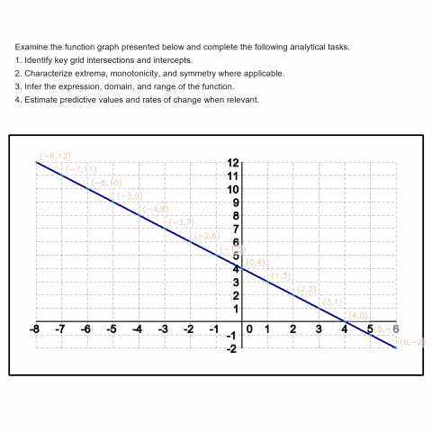
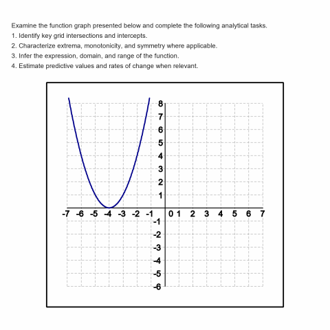
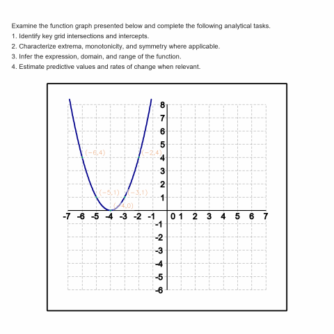
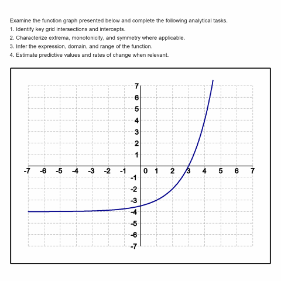
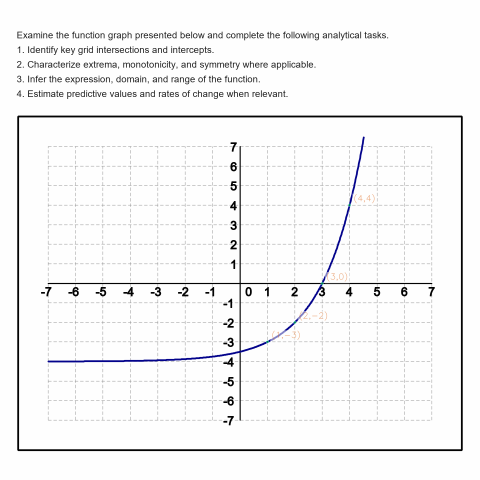
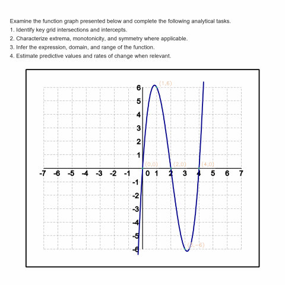

# GeoSym

**GeoSym: Structured Evidence Fusion for Reliable Quantitative Chart Reasoning**

Multimodal large language models have demonstrated remarkable capabilities in visual understanding, yet they remain prone to hallucination and imprecise numerical reasoning when confronted with tasks demanding quantitative accuracy. Existing enhancement strategies — including chain-of-thought prompting, self-consistency decoding, and tool-augmented reasoning — improve general reasoning but lack explicit mechanisms to assess the correctness and task-relevance of externally injected evidence; information, once obtained, is treated as uniformly reliable.

GeoSym is an evidence fusion framework for quantitative chart reasoning that manages how visual evidence is generated, scored, selected, and propagated through an LLM reasoning chain. The framework operates through four modules:

1. **M0 — Candidate Evidence Generation**: Computation-grounded visual extraction through geometric pixel-level analysis, producing coordinates, intercepts, extrema, and monotonicity intervals.
2. **M1 — Confidence-Scored Fact Construction**: Source reliability assessment transforming raw candidates into structured facts with heuristic confidence tiers.
3. **M2 — Utility-Aware Evidence Selection**: Utility-driven curation selecting a compact high-value evidence subset based on relevance, complementarity, and conflict risk — without performing numerical computation.
4. **M3 — Hierarchical Fusion Reasoning**: Layered reasoning that presents structured evidence as high-priority anchors or hypotheses across reading, analysis, and inference layers aligned with Curcio's graph comprehension taxonomy.

**Keywords:** Evidence fusion · Multimodal reasoning · Quantitative chart reasoning · Vision-language models · Evidence reliability

## M0 Visual Evidence Extraction — Examples

GeoSym's M0 module performs computation-grounded coordinate extraction via geometric pixel-level analysis. Below are examples from four function families showing original benchmark images (left) and M0 annotated outputs (right) with detected curve-grid intersection points:

<table>
<tr>
<th>Function Family</th>
<th>Original Image</th>
<th>M0 Annotated Output</th>
</tr>
<tr>
<td><b>Linear</b><br><code>y = ax + b</code></td>
<td></td>
<td></td>
</tr>
<tr>
<td><b>Quadratic</b><br><code>y = a(x-h)² + k</code></td>
<td></td>
<td></td>
</tr>
<tr>
<td><b>Exponential</b><br><code>y = a·b^(x-h) + k</code></td>
<td></td>
<td></td>
</tr>
<tr>
<td><b>Cubic</b><br><code>y = a(x-h)³ + b(x-h) + k</code></td>
<td></td>
<td></td>
</tr>
</table>

Each annotated image shows detected intersection points (green/yellow circles) with their computed real-valued coordinates. These coordinate anchors serve as the candidate evidence set that flows into M1 for confidence scoring and subsequent pipeline stages.

## Framework Architecture

GeoSym enforces a clear separation of concerns: computation-grounded modules (M0, M1) produce and score evidence; a language model (M2) performs semantic curation; and the reasoning module (M3) synthesizes across abstraction layers. Each module operates within its domain of competence.

### M0: Candidate Evidence Generation

M0 produces a candidate evidence set through deterministic, pixel-grounded visual extraction. The design principle is **competence separation**: OCR provides axis scale information, geometric computation establishes pixel-to-coordinate mappings, and visual analysis identifies data point locations. The framework is agnostic to the specific extraction algorithm — M0 defines an interface, allowing adaptation to different visual domains.

Two complementary implementations share a common ruler infrastructure:

- **Function-Specialized M0** (`recognizer/`): A deterministic geometric pipeline for charts with integer coordinate grids. Detects grid lines via Hough transform, establishes pixel-to-coordinate mapping, and identifies curve-grid intersection points. Stage 2.5 adds least-squares regression cross-validation using the shared ruler module.
- **Enhanced M0** (`presenter/`): A four-phase pipeline for real-world charts without integer grids. Phase 1 builds a coordinate ruler from OCR tick labels via least-squares regression. Phase 2 uses an LLM to locate semantically important points at the pixel level. Phase 3 converts pixel coordinates to chart units through the ruler. Phase 4 checks measurements against axis bounds and fuses evidence into a standardized format.
- **Shared Ruler** (`presenter/ruler.py`): OCR-based coordinate system construction used by both implementations. Supports linear, logarithmic, datetime, and categorical axis scales.

### M1: Confidence-Scored Fact Construction

M1 transforms raw candidates into structured facts with heuristic confidence tiers. Confidence is computed based on:

- Density of supporting pixel evidence
- Precision of grid alignment (exact grid-coincident vs. interpolated)
- Algebraic consistency across candidates (e.g., intercepts cross-checked against monotonicity)

Facts are assigned to three confidence tiers — **high**, **medium**, and **low** — with candidates below a minimum threshold discarded entirely.

### M2: Utility-Aware Evidence Selection

M2 curates a compact subset of scored facts for injection into the reasoning pipeline. A language model serves as the selection operator, assessing facts on three dimensions: **relevance**, **complementarity**, and **contradiction risk**. Critically, M2 performs no numerical computation — it operates purely in the semantic domain, deciding which facts are worth presenting to the reasoner.

Two injection strategies are supported:

- **Flat injection**: All retained facts as a single JSON block with confidence-gated values.
- **Tiered injection**: Facts organized into three epistemic tiers (high-priority coordinate evidence, detected features, inferred patterns).

### M3: Hierarchical Fusion Reasoning

M3 consumes the curated evidence through a three-layer reasoning hierarchy:

- **L1 (Reading)**: Extract or consolidate coordinates, intercepts, and extrema. Evidence is injected primarily at this layer.
- **L2 (Analysis)**: Perform quantitative analysis — function value predictions, rate of change, monotonicity, and symmetry.
- **L3 (Inference)**: Derive higher-order mathematical conclusions — closed-form expression, domain, and range.

Evidence injection at L1 ensures that stronger visual grounding propagates upward into L2 and L3, where abstract reasoning benefits from explicit, auditable anchors rather than implicit visual impressions alone.

## GeoSym-Bench

GeoSym-Bench is a controlled evaluation benchmark with complete ground-truth annotations across **8 function families**. The generated cohort contains **480 samples**; historical experiments are reported on a **460-sample complete-case subset** where all compared conditions completed successfully.

The dataset is hosted on HuggingFace: [lihaonan0716/GeoSym-Bench](https://huggingface.co/datasets/lihaonan0716/GeoSym-Bench)

```python
from huggingface_hub import snapshot_download
path = snapshot_download(repo_id="lihaonan0716/GeoSym-Bench", repo_type="dataset")
```

### Function Families

| Category | Family | General Form |
|----------|--------|--------------|
| Elementary | `linear` | y = ax + b |
| Elementary | `quadratic` | y = a(x−h)² + k |
| Elementary | `absolute` | y = a\|x−h\| + k |
| Polynomial | `cubic` | y = a(x−h)³ + b(x−h) + k |
| Polynomial | `piecewise_linear` | y = sᵢ(x−hᵢ) + kᵢ |
| Transcendental | `exponential` | y = a·b^(x−h) + k |
| Transcendental | `logarithmic` | y = a·log₂(x−h) + k |
| Special | `rational` | y = a/(x−h) + k |

### Evaluation Dimensions

Each image carries annotations across 10 evaluation dimensions scored with equal weight:

| Dimension | Description |
|-----------|-------------|
| D1: Intercepts | x- and y-intercepts |
| D2: Extrema | Local minima/maxima with type labels |
| D3: Predictions | Function values at specified non-integer x-values |
| D4: Rate of change | Average slope over a defined interval |
| D5: Monotonicity | Increasing/decreasing intervals |
| D6: Symmetry | Even, odd, or neither |
| D7: Expression | Closed-form formula |
| D8: Domain | Mathematical domain |
| D9: Range | Mathematical range |
| D10: Inference quality | Independently scored by judge model |

## Experimental Conditions

Six experimental conditions form a progressive enhancement spectrum:

| ID | Condition | Image | CoT | SC | OCR | GeoSym | Description |
|----|-----------|:-----:|:---:|:--:|:---:|:------:|-------------|
| E0 | DirectQA | ✓ | | | | | Raw image → MLLM single-pass |
| E1 | DirectQA-CoT | ✓ | ✓ | | | | With chain-of-thought decomposition |
| E2 | DirectQA-SC | ✓ | ✓ | ✓ | | | Self-consistency voting |
| E3 | OCRRulesQA | ✓ | | | ✓ | | Mathpix OCR extraction + rule-based feature computation |
| E4 | OCRRules-CoT | ✓ | ✓ | | ✓ | | Mathpix OCR + rule-based features + CoT |
| E5 | FullGeoSym | ✓ | | | | ✓ | Complete M0→M1→M2→M3 pipeline |

## Cross-Domain Evaluation

Beyond the controlled benchmark, GeoSym includes real-world chart demonstrations across three domains:

| Dataset | Source | License | Domain |
|---------|--------|---------|--------|
| FRED | [Federal Reserve Economic Data](https://fred.stlouisfed.org) | Public domain | Financial time-series |
| EngiSphere | [EngiSphere Stress-Strain Generator](https://engisphere.com/calculators/stress-strain-curve-generator/) | — | Engineering stress-strain diagrams |
| OmniScience | [Nature Communications](https://www.nature.com) | [CC-BY 4.0](https://creativecommons.org/licenses/by/4.0/) | Scientific figures |

OmniScience figures are reproduced under Creative Commons Attribution 4.0 (CC-BY 4.0). Original paper DOIs and full attribution are provided in [`assets/real_charts/README.md`](assets/real_charts/README.md).

M1–M3 modules operate without modification across domains; only M0 requires domain-specific instantiation via the Enhanced M0 pipeline (`presenter/`). These cases illustrate measurement traceability, feature localization, and source attribution rather than constituting a systematic external benchmark.

## Key Results

Across 460 evaluated samples with GPT-5.4 as the backbone MLLM:

| Condition | Mean Score | Δ vs. strongest baseline condition (E0) |
|-----------|:----------:|:----------------------------------------:|
| E0 (DirectQA) | 79.46 | — |
| E1 (DirectQA-CoT) | 78.88 | -0.58 |
| E2 (DirectQA-SC) | 78.81 | -0.65 |
| E3 (OCRRulesQA) | 78.17 | -1.30 |
| E4 (OCRRules-CoT) | 79.25 | -0.22 |
| **E5 (FullGeoSym)** | **93.67** | **+14.21** |

- FullGeoSym outperforms the strongest baseline condition (E0) by 14.21 points and the sample-wise best-of-baselines reference (per-sample maximum over E0–E4) by 10.67 points.
- 86% of samples (394/460) achieve positive improvement over the sample-wise best-of-baselines reference; 93.3% of samples (429/460) improve over E0.
- Ablation (E5_raw: M0+M3 only) scores 93.48, estimating a large aggregate incremental effect from adding generated visual evidence and hierarchical reasoning (+14.02 over E0).
- M1–M2 curation is marginal at aggregate (+0.19, not a significant main effect). The larger +2.42 effect on the 18% of samples where extraction quality degrades is reported only as a post-hoc diagnostic, not as confirmatory robustness evidence.

## Repository Structure

```text
GeoSym/
├── generator/       # Benchmark generation and mathematical ground truth
├── recognizer/      # Function-specialized M0 (grid-based coordinate extraction)
├── presenter/       # Enhanced M0 (ruler + LLM locate) + real-world chart showcase
├── evaluator/       # LLM adapters, metrics, reasoning (M1/M2/M3)
├── prompts/         # Prompt templates for all pipeline stages
├── app/             # Gradio UI and backend modules
├── config/          # Configuration files and API key template
├── scripts/         # CLI tools
├── tests/           # Test suite
├── docs/            # Technical documentation
├── i18n.py          # Bilingual internationalization (EN/ZH)
├── run.py           # Application entry point
└── requirements.txt
```

| Directory | Role |
|-----------|------|
| `generator/` | Benchmark generation: synthetic function-graph images, perturbations, and exact ground truth |
| `recognizer/` | GeoSym's visual extraction backbone for coordinate evidence on controlled benchmarks |
| `presenter/` | Enhanced M0 pipeline (ruler, measure, verify) and real-world chart showcase flows |
| `evaluator/` | Structured fusion logic, LLM adapters, reasoning scoring, judge scoring, baselines, and response parsing |
| `app/` | Gradio application: UI construction, reasoning pipeline, experiment runners, caching |
| `prompts/` | Prompt templates for reasoning layers, judge evaluation, M0 locate, visual fact inference |
| `scripts/` | CLI tools for dataset generation and related utilities |
| `tests/` | Pytest suite covering the public surface and the evidence-channel contracts |

## Setup

```bash
python -m pip install -r requirements.txt
```

Core dependencies include OpenCV, NumPy, Pillow, PyYAML, Gradio, and SymPy. The experiments reported in the paper use Mathpix OCR for E3/E4 and for OCR-derived axis/tick extraction; configure Mathpix credentials in `config/api_keys.yaml`. EasyOCR remains available in the codebase for local OCR workflows, but it is not the reported OCR/rule baseline.

Copy `config/api_keys.yaml.example` to `config/api_keys.yaml` and fill in your API keys. GPT and Claude adapters use an API-compatible gateway base URL from `ninerouter_base_url`, `NINEROUTER_BASE_URL`, `GEOSYM_OPENAI_BASE_URL`, or `GEOSYM_CLAUDE_BASE_URL`; the public repository does not hardcode a private gateway URL.

## Testing

Install development dependencies and run tests through the active Python interpreter:

```bash
python -m pip install -r requirements-dev.txt
python -m pytest -q
```

Using `python -m pytest` avoids accidentally invoking a globally installed `pytest` from a different Python environment.

## Supported LLM Providers

| Provider | Models | Adapter |
|----------|--------|---------|
| OpenAI-compatible gateway | GPT-5.5 | `evaluator/adapters/openai.py` |
| Google | Gemini-3.1-Pro, Gemini-3-Pro | `evaluator/adapters/gemini.py` |
| Anthropic-compatible gateway | Claude-Opus-4.8, Claude-Opus-5 | `evaluator/adapters/claude.py` |
| Alibaba | Qwen3.5-Plus, Qwen3-VL-Plus | `evaluator/adapters/qwen.py` |
| Moonshot | Kimi-K2.5, Moonshot-V1 | `evaluator/adapters/kimi.py` |
| ZhipuAI | GLM-4.6V | `evaluator/adapters/glm.py` |

All adapters use `temperature=0.0` for maximum determinism, except `Kimi-K2.5` (`temperature=1.0` per API constraint). OpenAI additionally sets `seed=42`.

## Configuration

Primary configuration: `config/default_config.yaml`

Key sections:

- `page`, `chart`, `coords`, `ticks`, `curves`, `noise`: image generation and perturbation
- `reasoning.layers`: evaluation dimension definitions
- `reasoning.intervention`: GeoSym fusion settings
- `reasoning.judge`: judge LLM configuration
- `models`: LLM provider and model registry
- `output`: dataset locations

## Generate Benchmark Data

```bash
python scripts/run_generate.py --count 20 --seed 42 --out-dir dataset
```

With a custom config:

```bash
python scripts/run_generate.py --count 50 --config config/my_config.yaml --out-dir dataset
```

CLI flags:

- `--count`: number of samples per subset
- `--config`: YAML config path
- `--seed`: reproducible seed
- `--out-dir`: target directory for `images/` and `ground_truth/`

## Ground Truth Layout

Each generated image has a paired JSON file containing:

- `chart_bbox`, `page_size`, `layout`
- `x_range`, `y_range`, tick metadata
- `intersections`
- `functions` (parameters, expressions, type)
- `question.ground_truth` (all 10 evaluation dimensions)
- `extended_properties` (intercepts, extrema, monotonicity, symmetry)
- `benchmark_meta` (function family, noise profile, seed)

## Web UI

```bash
python run.py
```

| Tab | Features |
|-----|----------|
| **GeoSym Function-Specialized M0 Demo** | Interactive coordinate extraction with stage-by-stage visualization |
| **Benchmark Generation** | Generate images by function family and noise profile, with full ground truth preview |
| **GeoSym Full Function Reasoning** | Single-image six-condition reasoning, rerun controls, and cache management |
| **Real-World Showcase** | Qualitative demonstrations on real scientific charts using Enhanced M0 |
| **Connection Test** | Verify LLM API connectivity for configured providers |

## Minimal Programmatic Use

```python
from generator.config_loader import load_config
from generator.core import generate_one

cfg = load_config()
img, gt = generate_one(cfg, output_image_path="out.png", output_gt_path="out.json", seed=1)
```

## License

This repository is licensed under the [MIT License](LICENSE). The GeoSym-Bench dataset is hosted separately on [HuggingFace](https://huggingface.co/datasets/lihaonan0716/GeoSym-Bench) under [CC-BY 4.0](https://creativecommons.org/licenses/by/4.0/).

## Citation

If you use GeoSym in your research, please cite:

```bibtex
@misc{wang2026geosym,
  title     = {GeoSym: Structured Evidence Fusion for Reliable Quantitative Chart Reasoning},
  author    = {Wang, Yongqing and Zhang, Qisheng and Guo, Linyan and Li, Haonan and Sun, Tianjun and Yu, Samson S.},
  year      = {2026},
  note      = {Manuscript in preparation. Software and dataset available online},
  url       = {https://github.com/lihaonan0716/GeoSym}
}
```

> The citation will be updated with the published DOI upon acceptance.
